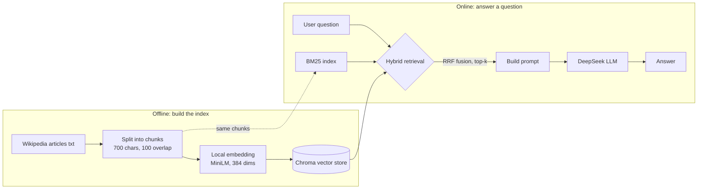
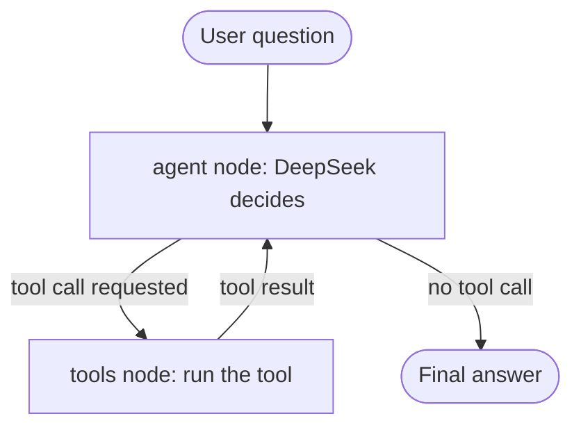

# Agent RAG Assistant

A question-answering assistant with **tool calling**. It answers knowledge-base questions with **RAG (retrieval-augmented generation)**, uses **hybrid retrieval** (vector + BM25, fused with RRF), and runs a multi-step **LangGraph** agent in which the LLM decides on its own whether to call a tool and which one.

- **Retrieval:** local embeddings + Chroma vector search, fused with BM25 keyword search via Reciprocal Rank Fusion (RRF)
- **Agent:** three tools (knowledge-base search, calculator, date lookup); the model routes between them and can chain several calls
- **Evaluation:** a self-built retrieval evaluation set (68 questions) and a tool-routing evaluation set (22 questions); every number below can be reproduced with the scripts in `src/`

## Architecture

**Knowledge-base question answering (`query.py`, fixed pipeline)**



**Agent (`graph_agent.py`, LangGraph)**



The model only *requests* tool calls; the tools run as ordinary Python code on the local machine, and their results are handed back to the model. The loop repeats until the model stops requesting tools.

## Tools

| Tool | What it does |
|---|---|
| `search_knowledge_base` | Runs hybrid retrieval and returns the 4 most relevant passages |
| `calculate` | Evaluates a math expression. It does not use `eval()`; the expression is parsed with `ast` and only whitelisted operators (`+ - * /`, `**`, unary `+`/`-`) are evaluated, which prevents code injection |
| `get_current_date` | Returns the current system date |

## Results

### Retrieval comparison

68 questions, each labelled with the source file its answer comes from. A question counts as a hit if the top-k retrieved chunks include that file. (All questions are in English.)

| Method | Top-1 hit rate | Top-4 hit rate |
|---|---|---|
| Vector-only | 89.7% (61/68) | 100% |
| BM25-only | 94.1% (64/68) | 100% |
| **Hybrid (RRF, `fetch_k=6`)** | **95.6% (65/68)** | 100% |

At top-4 all three methods reach 100%: these questions are fairly easy for retrieval (a ceiling effect), so the methods can only be told apart at top-1. That is why both thresholds are reported.

### Agent tool routing

22 questions in four categories: date lookup, arithmetic, knowledge-base lookup, and small talk that needs no tool. A question is correct if the expected tool was called and no other type of tool was called (small talk: no tool at all).

- Routing accuracy: **21/22 = 95.5%**, identical across 3 consecutive runs
- The one miss is *"Who painted the Mona Lisa?"*: the model answers from its own knowledge without querying the knowledge base. The model is free to skip a tool when it believes it already knows the answer, which is expected for Wikipedia topics it has seen in training. The knowledge base matters most for content the model has not seen.
- Multi-step example: asked *"How many years apart were Darwin's theory of evolution and the discovery of the DNA double helix?"*, the agent queries the knowledge base for both events, then calls the calculator (`1953 - 1859 = 94`).

## Quick start

Requirements: Python 3.11 and a [DeepSeek](https://platform.deepseek.com) API key.

```bash
conda create -n agent-rag python=3.11 -y
conda activate agent-rag
pip install -r requirements.txt

# Configure the API key: copy .env.example to .env and set DEEPSEEK_API_KEY
copy .env.example .env        # use `cp` on macOS/Linux

python test_setup.py          # check the API key and network
python src/download_model.py  # download the local embedding model (~450 MB, from the hf-mirror.com mirror by default)
python src/ingest.py          # read data/docs and build the vector index
```

Usage:

```bash
python src/query.py "What is a black hole?"      # fixed-pipeline knowledge-base QA (hybrid retrieval)
python src/graph_agent.py "What is today's date?" # agent: the model decides whether to call a tool
python src/graph_agent.py "How many years apart were Darwin's theory of evolution and the discovery of the DNA double helix?"
```

Reproduce the experiments:

```bash
python src/eval_retrieval.py       # retrieval comparison (top-1 / top-4)
python src/eval_agent_routing.py   # tool-routing accuracy
```

## Project structure

```
src/
├── corpus.py                  # load documents and split them into chunks (PDF and txt)
├── ingest.py                  # build the index: chunks -> embeddings -> Chroma
├── retrieval.py               # Retriever: vector search / BM25 / hybrid search (RRF)
├── query.py                   # knowledge-base QA (fixed pipeline)
├── tools.py                   # the three tools
├── agent.py                   # single-round tool calling (reference version)
├── graph_agent.py             # multi-step LangGraph agent
├── eval_retrieval.py          # retrieval evaluation
├── eval_agent_routing.py      # routing evaluation
├── download_model.py          # download the local embedding model
└── fetch_wikipedia_corpus.py  # fetch the corpus
data/docs/                     # corpus (68 Wikipedia articles)
```

## Design notes

- **Why RRF:** the raw scores of vector search and BM25 are on different scales, so adding them with weights is not meaningful. RRF uses ranks only (each list contributes `1/(60 + rank)`), so no score normalisation is needed. Each retriever contributes its top `fetch_k=6` candidates to the fusion.
- **Same chunks for both retrievers:** vector search and BM25 run over the same chunks, so their results are comparable and can be fused.
- **`temperature=0`:** routing decisions should be stable, so sampling randomness is turned down.
- **Thread safety:** LangGraph can run several tool calls of one round concurrently, so the retriever is loaded lazily behind a lock to avoid concurrent initialisation.

## Known limitations

- Both evaluation sets are hand-built weak labels that only check whether the right *source file* was found, and the samples are small (68 and 22 questions).
- `fetch_k` was tuned on the same 68 questions that are reported, so the numbers are somewhat optimistic. With `fetch_k=20`, hybrid top-1 is 94.1%, still above vector-only.
- The BM25 tokenizer only handles Latin letters and digits, so for Chinese (or other non-Latin) questions the BM25 side effectively returns nothing useful and the system relies on vector retrieval. All evaluation questions are in English.
- No reranking step (cross-encoder) is implemented.
- Even with `temperature=0`, a hosted API does not guarantee fully deterministic output.
- The agent prompt does not instruct the model to answer only from retrieved context, so its protection against hallucination is weaker than in the fixed-pipeline `query.py`.

## Corpus and license

The text in `data/docs/` comes from [Wikipedia](https://www.wikipedia.org/) and is licensed under [CC BY-SA 4.0](https://creativecommons.org/licenses/by-sa/4.0/); each file name is the title of the corresponding article. It can be re-fetched with `python src/fetch_wikipedia_corpus.py`, or you can put your own PDF/txt files into `data/docs/` and re-run `ingest.py`.

## Tech stack

Python · LangChain · LangGraph · Chroma · rank_bm25 · sentence-transformers (`paraphrase-multilingual-MiniLM-L12-v2`) · DeepSeek API
